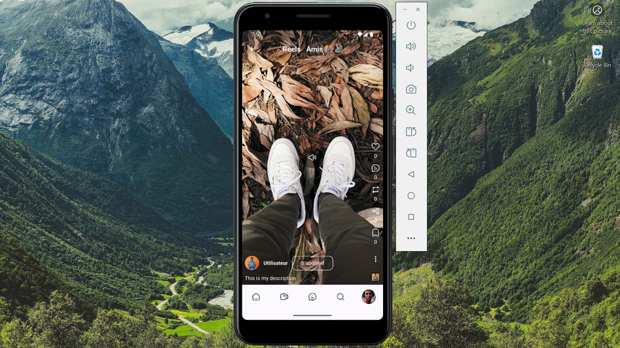
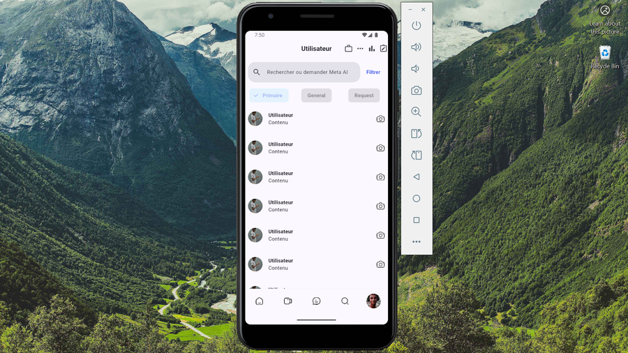
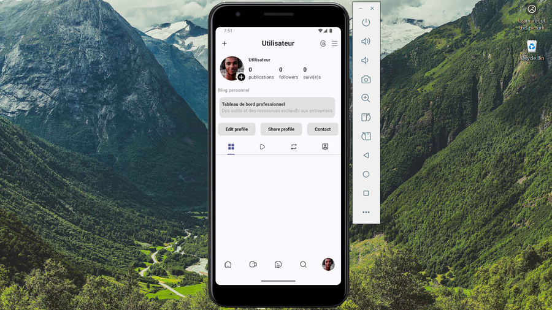

# Clones — laboratoire d'interfaces Flutter

Reproductions pédagogiques d'interfaces d'applications populaires, réalisées avec Flutter pour travailler les layouts avancés (Slivers, scrolls imbriqués, carrousels) et le souci du détail UI/UX.

> ⚠️ Ces reproductions sont des **exercices indépendants d'apprentissage UI**. Elles ne sont ni affiliées ni approuvées par les plateformes originales. Les marques, logos et interfaces appartiennent à leurs propriétaires respectifs.

## Catalogue

### [Facebook](apps/facebook_clone) — `apps/facebook_clone`

Reproduction de l'UI Facebook : feed, reels, invitations, marketplace, notifications et menu.

- **Concepts travaillés :** `NestedScrollView`, Slivers, listes complexes, responsive.
- **Packages :** `fluent_ui`, `google_fonts`, `font_awesome_flutter`, `gap`.

| Accueil | Reels | Marketplace | Menu |
|---|---|---|---|
|  |  |  |  |

### [Instagram](apps/instagrame_clone) — `apps/instagrame_clone`

Reproduction de l'UI Instagram : feed, reels, messages, recherche et profil.

- **Concepts travaillés :** `CustomScrollView`, Slivers, carrousels, avatars empilés.
- **Packages :** `hugeicons`, `google_fonts`, `gradient_borders`, `provider`, `gap`.

| Accueil | Reels | Message | Profil |
|---|---|---|---|
|  |  |  |  |

## Lancer un clone

Chaque application est un projet Flutter indépendant :

```bash
cd apps/facebook_clone      # ou apps/instagrame_clone
flutter pub get
flutter run
```

## Structure

```
Clones/
├── apps/
│   ├── facebook_clone/       # Projet Flutter indépendant
│   └── instagrame_clone/     # Projet Flutter indépendant
└── README.md
```

## Licence

[MIT](LICENSE)
