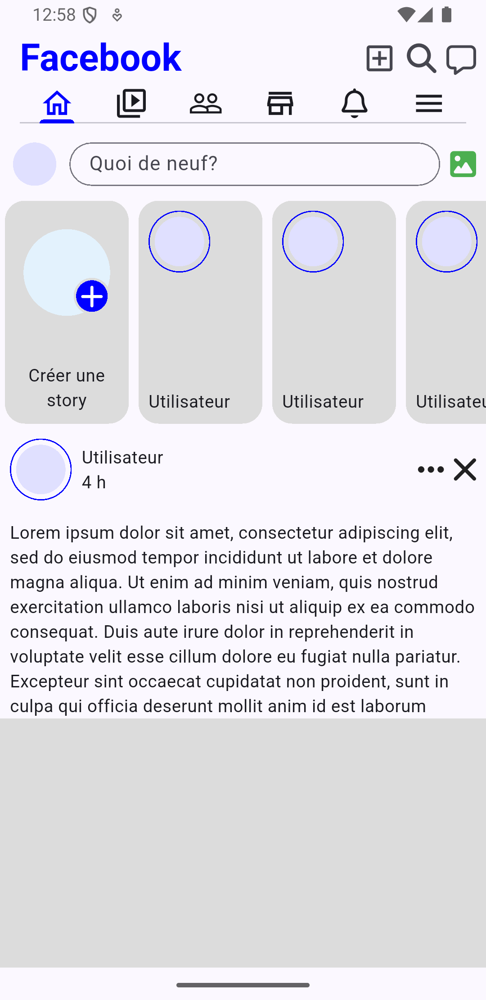
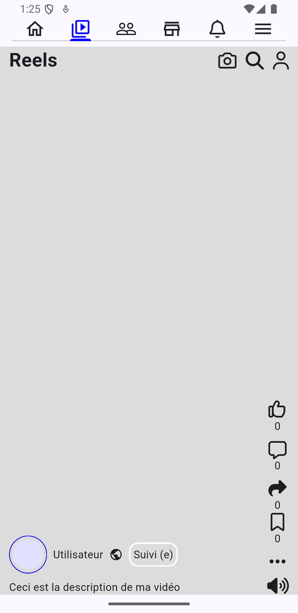
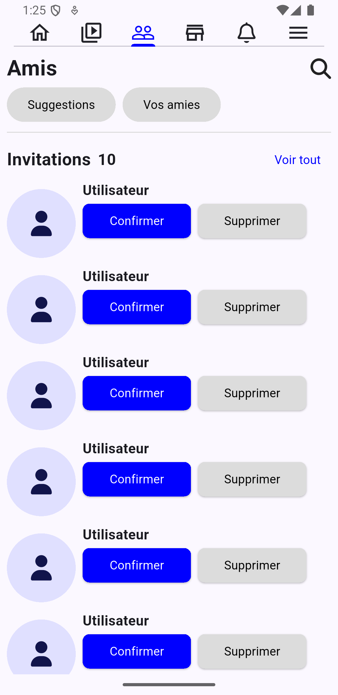
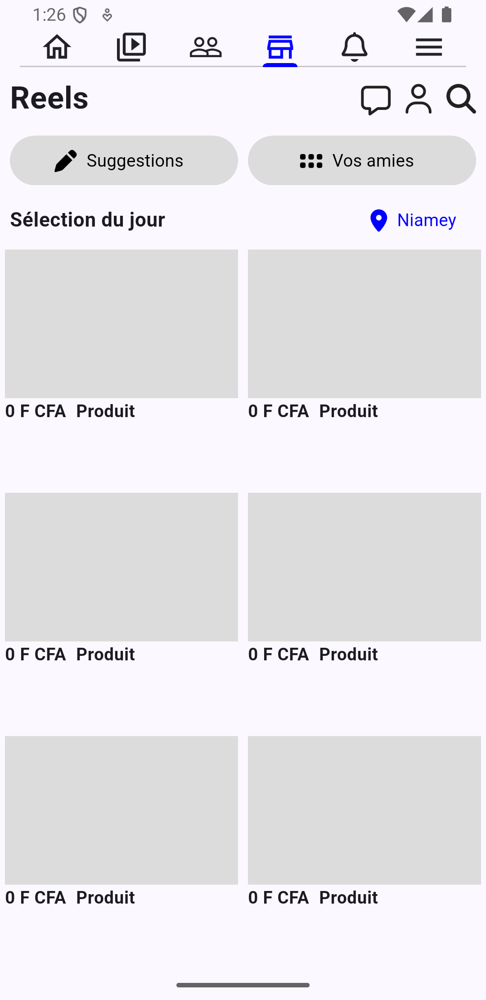
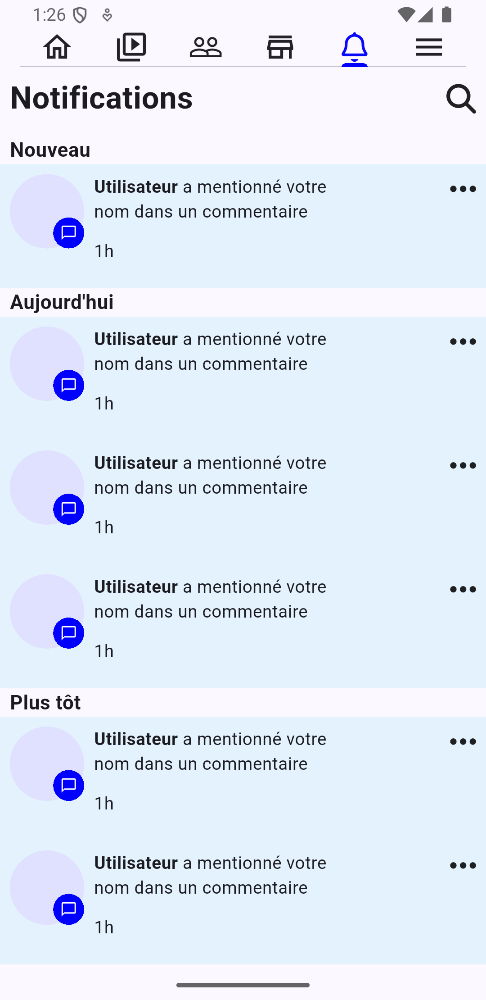
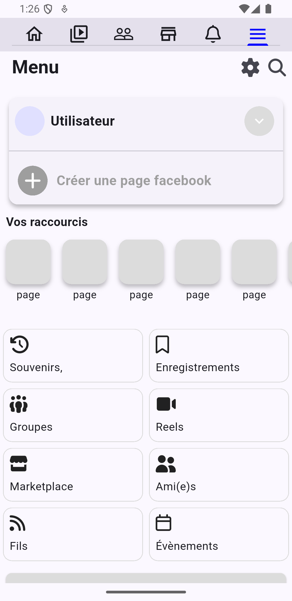

# Facebook clone

Une reproduction de l'interface de base de l'application Facebook, réalisée avec Flutter.

> Exercice indépendant d'apprentissage UI, non affilié à Meta / Facebook.

## Écrans réalisés

- **Accueil**
- **Aperçu**
  


- **Reel**
- **Aperçu**
  


- **Invitations**
- **Aperçu**
  


- **Marketplace**
- **Aperçu**
  


- **Notifications**
- **Aperçu**
  


- **Menu**
- **Aperçu**
  


## Ce que j'ai appris

- Gestion et utilisation du NestedScrollView et des Slivers

## Packages principaux utilisés

- `fluent_ui`
- `google_fonts`
- `font_awesome_flutter`
- `gap`

## Lancer l'application

```bash
flutter pub get
flutter run
```


