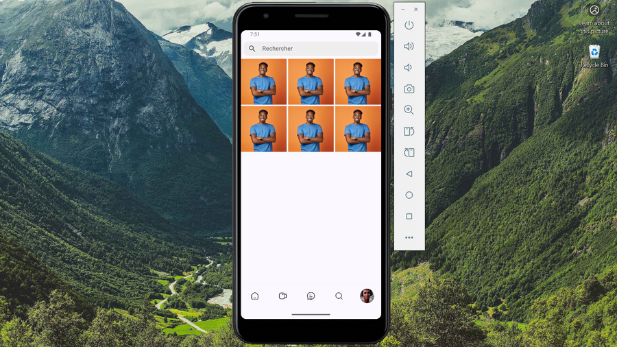

# Instagram clone

Une reproduction de l'interface de base de l'application Instagram, réalisée avec Flutter.

> Exercice indépendant d'apprentissage UI, non affilié à Meta / Instagram.

## Écrans réalisés

- **Accueil**
- **Aperçu**
  


- **Reels**
- **Aperçu**
  


- **Message**
- **Aperçu**
  


- **Recherche**
- **Aperçu**
  


- **Profil**
- **Aperçu**
  


## Ce que j'ai appris

- Gestion et utilisation du CustomScrollView et des Slivers

## Packages principaux utilisés

- `hugeicons`
- `google_fonts`
- `gradient_borders`
- `provider`
- `gap`

## Lancer l'application

```bash
flutter pub get
flutter run
```


